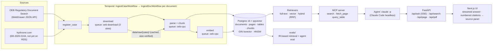
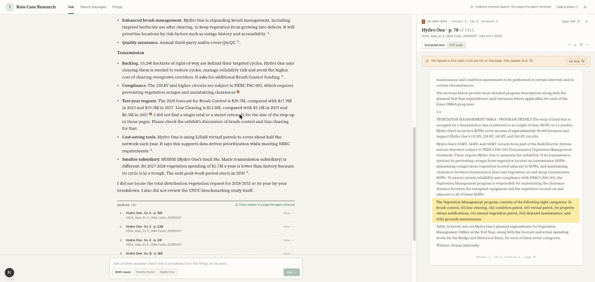

# OEB rate-case research agent

Ask a question about an Ontario Energy Board rate case and get an answer in which every claim
links to the page of the filing it came from. Built over two real proceedings:

| Case | Utility | Filing |
|---|---|---|
| [EB-2023-0195](https://www.rds.oeb.ca/CMWebDrawer/Record?q=CaseNumber:EB-2023-0195) | Toronto Hydro-Electric System Limited | 2025–2029 custom IR application, settled 2024 |
| EB-2026-0164 | Hydro One Networks Inc. | 2028–2032 joint transmission + distribution application, filed 2026-10-07 |

## The problem

A single rate case is hundreds of PDFs and tens of thousands of pages: pre-filed evidence,
interrogatories (written questions from intervenors and OEB staff) and the utility's responses,
undertakings, settlement proposals, decisions. Answering "what is the utility proposing and why"
means finding the right exhibit, tab, schedule and page, and quoting it exactly. This project
ingests whole cases, retrieves at page level, and answers with an agent that must cite pages it
actually read, or say the evidence isn't there.

## Architecture



**Ingestion.** `oeb.sources.rds` lists a case through RDS's JSON search API (100 records per page; 1,000
times out server-side) and downloads each record from `/CMWebDrawer/Record/{uri}/File/document`. Every
request goes through one fetcher that spaces requests ≥1.1 s apart per host (shared across processes
with a file lock), sends a descriptive User-Agent, caches every response on disk, and verifies the byte
count. RDS truncates large files by exactly 80 KiB when it streams the whole file (with a 200 status),
but serves byte ranges intact and reports the true size in `Content-Range`. So files are fetched in
8 MiB ranges, each piece is length-checked, and the total must match both `Content-Range` and the size
RDS lists. PyMuPDF extracts text per page. Margin line numbers and the header block (`Exhibit 2B / Tab 1 /
Schedule 1 / Page n of m`, or `Section D1` in Exhibit 2B) are stripped from the text, and the header
becomes the page's exhibit reference. Appendix pages without a header inherit the preceding schedule's
reference. pdfplumber extracts tables only on pages with ruling lines. Chunks follow detected headings,
target 500–800 tokens, never cross an exhibit boundary, and keep their page range. Embeddings use
`BAAI/bge-small-en-v1.5` locally.

**Orchestration.** One child workflow per document runs download → parse/chunk → embed. Each activity
is idempotent on `documents.status`, so re-running a case skips finished documents. Network-bound and
CPU-bound activities use separate task queues with separate concurrency limits, so a slow RDS response
(RDS sometimes takes >4 minutes to first byte) never blocks parsing. Each host gets one request in
flight at a time, and a host-wide circuit breaker backs off when a server starts failing. Activities
heartbeat, so a restarted worker's work is retried within a minute. Because the download queue is FIFO,
`oeb.crawl --process` can run alongside the worker to fetch the documents the eval needs first; the
workflow's activities then find that work done and skip it.

**Retrieval.** Three retrievers return chunks with case/exhibit/page citations:
1. *Full-text*: Postgres `tsvector` with `ts_rank_cd`. This is BM25-*style*, not BM25: there is no IDF
   term, so query words found in more than 10% of chunks ("toronto", "hydro", "rate") are dropped
   before ranking (a document-frequency table refreshed after each ingest).
2. *Vector*: cosine over bge-small embeddings (HNSW, iterative scan for filtered queries).
3. *Hybrid*: reciprocal rank fusion (k=60) over the top 50 of each.

Utilities re-file updated exhibits, so 16% of Toronto Hydro's chunks are verbatim copies of
another chunk. All retrievers collapse exact copies (hash of normalized text, keeping the latest
filing) and near-copies (word 5-gram Jaccard ≥ 0.8), so re-filings don't crowd out other passages.

**Agent.** The agent runs through Claude Code in headless mode (`claude -p`, model `claude-sonnet-5-5`)
on the user's own Claude plan, not API billing. A guard (`oeb/agent/claude_cli.py`) strips API keys
and cloud-provider settings from the subprocess environment, requires `claude auth status` to report a
claude.ai login, and aborts any run whose init event reports an API key. The agent is isolated from
local Claude Code configuration: no built-in tools, no settings/plugins/CLAUDE.md, no session
persistence. Its only tools come from a stdio
MCP server:
- `search` (hybrid)
- `fetch_page`
- `query_table`: read-only SQL, run as a database role that can only SELECT two views

Every claim must carry a `[cite:doc_id:page]` token copied from a tool result. Tokens are then checked
against the pages the agent actually saw, and unverified ones are flagged in the UI.

**UI.** The UI is designed to read like the record itself: serif text, footnote citations, and a source
panel that shows the cited page, with the matching passage highlighted, beside the answer.



- **Thread:** the agent's searches and page reads stream in as steps, then the answer arrives with a
  footnoted source list. Every source has to pass the citation check.
- **Source panel:** shows the cited page's extracted text with the passage that best matches the cited
  sentence highlighted, or the PDF itself.
- **Figure check:** if none of a claim's figures (for example "$220.9M") appear on the cited page, the
  panel says so and checks the two pages on either side. In two test questions it caught off-by-page
  citations: p. 352 instead of p. 354 in a Toronto Hydro undertaking response, and p. 78 instead of
  p. 79 in Hydro One's Exhibit E (shown above). In both cases the agent had retrieved the page, so
  the citation check alone passed them.
- **Other views:** *Passage search* runs the same retrievers with no language model, and you can switch
  between hybrid, vector and full-text. *Filings* lists every ingested document by case and type.

## Evaluation

Ground truth comes from the case itself. In OEB proceedings, intervenors file interrogatories (IRs),
and the utility's written responses usually point to the evidence that answers them ("see Exhibit 2B,
Section E5.4"). `evals/build_ir_set.py` parses the utility's IR response documents into
(question, response, exhibits cited in the response) rows and keeps only rows with an explicit exhibit
reference.

**Leakage controls.** The IR responses are part of the corpus, and the questions themselves name
exhibits. So:
- Retrieval during eval is restricted to the utility's pre-filed **evidence**. IR responses,
  undertakings, settlement proposals, arguments and decisions (which quote IR answers) are excluded
  by a filter inside the SQL, which is equivalent to removing them from the index.
- Document type comes from the title as well as RDS's tag. Three Toronto Hydro IR-response updates
  are tagged "Application and Evidence" on RDS; before this fix they sat in the evidence index and
  inflated the scores.
- Queries are the question with every record location stripped: exhibit/tab/schedule/page/section
  references, IR numbers (`2B-SEC-45` encodes the exhibit) and case numbers.
- Gold labels are the locations cited in the *response*, not the question's "Reference:" line (both
  variants are reported). The agent eval also limits the agent's tools to the question's own case.
- An ablation reruns hybrid search with IR documents left in to show what the leak would do.

**Metrics.**
- Retrieval: recall@k and MRR@10 at two levels.
  - **Section/schedule level** is the headline. A hit is a chunk on a page whose header matches a
    section, tab or schedule the utility cited ("Exhibit 4, Tab 2, Schedule 14"; "Exhibit 2B,
    Section E5").
  - **Exhibit level** is reported for completeness but is weak here. There are about a dozen exhibits
    and the labels are skewed toward 2B, so a prior that always answers "2B, 1B, 3" beats every
    retriever.
  - Random-chunk and label-prior baselines are shown next to both.
- Agent (held-out, seeded 20-question slice; small, so the README reports counts alongside rates):
  - citation accuracy, at section/schedule and exhibit level: does it cite a page the utility cited?
  - answer correctness: a Claude Opus 5.5 judge compares the answer with the utility's actual response.
- Sample reviews:
  - 20 seeded IR rows for label quality (`evals/ir_sample_review.md`).
  - 20 judge verdicts for agreement (`evals/judge_review.md`).
  - These were reviewed by Claude, not a human. The sheets say so, and the numbers update if they are
    re-marked by hand (`uv run python -m evals.record_hand_checks`).

## Results

<!-- results:start -->
_Generated by `uv run python -m evals.run` on 2026-10-22._

**Corpus**

| Case | Records | PDFs | Ingested | Pages | Chunks | Tables | MB |
|---|---|---|---|---|---|---|---|
| EB-2023-0195 | 611 | 326 | 326 | 30,211 | 20,441 | 10,205 | 1128 |
| EB-2026-0164 | 14 | 14 | 14 | 11,656 | 8,835 | 4,531 | 346 |

**Retrieval**

Retrieval on 470 IR questions (EB-2023-0195), evidence-only index, k=10.

**Exhibit level**: a hit is any chunk from an exhibit the utility cited in its response.

| Retriever | Recall@1 | Recall@5 | Recall@10 | MRR@10 | Median latency |
|---|---|---|---|---|---|
| fts | 0.570 | 0.830 | 0.906 | 0.682 | 234 ms |
| vector | 0.679 | 0.879 | 0.917 | 0.760 | 53 ms |
| hybrid | 0.687 | 0.879 | 0.921 | 0.769 | 344 ms |
| _random chunks (20 seeds)_ | 0.340 | 0.746 | 0.844 | 0.507 |  |
| _label prior (always 2B, 1B, 4, ...)_ | 0.602 | 0.940 | 1.000 | 0.740 |  |

**Section/schedule level** (449 questions whose response cites a section, tab or schedule): a hit is a chunk on a page whose header matches it.

| Retriever | Recall@1 | Recall@5 | Recall@10 | MRR@10 |
|---|---|---|---|---|
| fts | 0.312 | 0.535 | 0.644 | 0.405 |
| vector | 0.463 | 0.677 | 0.748 | 0.551 |
| hybrid | 0.445 | 0.664 | 0.733 | 0.536 |
| _random chunks_ | 0.041 | 0.164 | 0.284 | 0.097 |

Secondary (exhibit level, gold = exhibit named in the question's reference line / IR number):

| Retriever | Recall@5 | MRR@10 |
|---|---|---|
| fts | 0.828 | 0.658 |
| vector | 0.887 | 0.780 |
| hybrid | 0.894 | 0.778 |

Leakage ablation: without the evidence-only filter, hybrid top-5 contains the utility's own answer to the question (matched by text, in any filing) for **65.7%** of questions.

Eval set: 470 labelled IR questions from 938 parsed interrogatories (41 response documents).

**Agent**

Agent eval on 20 held-out IR questions (agent `claude-sonnet-5-5`, judge `claude-opus-5-5`), evidence-only tools, record locations stripped from questions.

| Metric | Value |
|---|---|
| Citation accuracy, section/schedule level (n=20) | 90.0% |
| Citation accuracy, exhibit level (cites an exhibit the utility cited) | 95.0% |
| Judge: correct | 10.0% |
| Judge: correct or partially correct | 95.0% |
| Verdicts (correct / partial / incorrect / abstained / error) | 2 / 17 / 0 / 1 / 0 |
| Citations to pages the agent never saw | 0.0% |
| Median tool calls / seconds per question | 8 / 35.2 |


**Sample reviews**

- IR eval-set rows passing the full review rubric (complete question, right response, every gold exhibit is an answer location): 17/20 = 85% (reviewed by Claude (claude-opus-5-5 in Claude Code), not a human)
- IR eval-set rows whose gold exhibits locate the answer to the queried question: 18/20 = 90% (reviewed by Claude (claude-opus-5-5 in Claude Code), not a human)
- Agreement with the LLM judge's verdicts: 19/20 = 95% (reviewed by Claude (claude-opus-5-5 in Claude Code), not a human)
<!-- results:end -->

### Reading the results

- **Section/schedule level is the number that matters.**
  - Vector search finds a page from the section or schedule Toronto Hydro cited in the top 5 for
    68% of questions, against 16% for random chunks.
  - Hybrid (66%) does not beat vector here. Full-text (54%) is clearly weaker and pulls the fusion
    down slightly. RRF only helps at exhibit level and on the question-reference variant.
- **Exhibit-level recall looks high but is weak evidence.** There are about a dozen exhibits and
  the labels are skewed toward 2B, so a label prior that always answers "2B, 1B, 4" gets recall@5
  0.94. Retrieval beats it only at rank 1.
- **The leakage control is necessary.** Without it, the utility's own answer to the question
  appears in the top 5 for about two thirds of questions, so any retrieval number would mostly
  measure lookup.
- **Agent:**
  - 20 held-out questions, so each answer moves a rate by 5 points.
  - Every citation pointed to a page the agent had actually read.
  - It cited a section or schedule the utility cited for 18 of 20 questions.
  - The judge rated 19 of 20 answers correct or partially correct, but only 2 fully correct.
    Since the parser fix the agent sees the whole multi-part interrogatory (often four to ten
    sub-questions), and the judge gives full credit only if every part matches the utility's
    response. Many parts ask for information that is not in the pre-filed evidence (new
    analysis, 2023 actuals, Excel files), so "partially correct" is the typical ceiling.
  - The 1 abstention (`9-STAFF-350`) asks whether a variance sub-account can be disposed of. The
    utility's answer turns on later balances transferred into that sub-account, which the agent
    did not find in the pre-filed evidence.
- **Eval-set label quality (sample of 20, reviewed by Claude, not a human):**
  - 18 of 20 rows have gold exhibits that locate the answer to the question in the query (90%).
  - 17 of 20 pass the stricter rubric, which also requires the question to be complete and
    unmixed. Two fail because a response-table footnote lands in the question field when it
    falls between sub-question blocks on a page; the third cites an exhibit only as where
    figures are "not yet available".
  - The previous review (on the eval set before the parser fix) found 14 of 20 and 8 of 20, and
    turned up two parser bugs, both now fixed (`src/oeb/irparse.py`, with regression tests):
    - Multi-part IRs alternate `QUESTION (B):` / `RESPONSE (B):` blocks. Later sub-questions
      used to land in the response field, so the query was only part (a) and a gold exhibit
      could come from a later part. All question blocks now go to the question and all
      response blocks to the response.
    - References to exhibits of *other* proceedings ("EB-2018-0165, Exhibit 9") used to be
      counted as gold. An exhibit qualified by a different EB case number is now ignored.
  - The pre-fix eval set, results and reviews are kept in `evals/results/v1/` (eval set sha256
    `1381cff3…`); the current set is `c2854e25…`.
  - The judge review found 19 of 20 verdicts agreeable. This is weaker evidence than a human
    check, since the reviewer and the judge are both Claude models.
- **Cross-case comparisons:** six questions comparing Toronto Hydro and Hydro One (capital growth,
  ROE and capital structure, rate frameworks, bill impacts, ...) have no ground truth. They are
  answered in [`evals/results/comparisons.md`](evals/results/comparisons.md) for review.
  - Every answer cites both cases.
  - 1 of 62 citations was flagged by the citation check: the agent shortened a document ID, so it
    pointed at a document that does not exist.
- **Cost:** each agent eval run uses about $5–5.50 equivalent of Claude plan usage (Claude Code's
  estimate), with no API billing.

## Running it

Prerequisites: Docker, [uv](https://docs.astral.sh/uv/), Node 20+, the Temporal CLI
(`brew install temporal`), and [Claude Code](https://claude.com/claude-code) logged in (for the agent).

```bash
uv sync && npm --prefix web install
make up                                    # Postgres + Temporal dev server + worker + API + web UI
uv run python -m oeb.ingest EB-2023-0195   # in another shell; re-run any time, finished docs are skipped
uv run python -m oeb.ingest EB-2026-0164
uv run python -m evals.build_ir_set EB-2023-0195
uv run python -m evals.run                 # regenerates evals/results/* and the Results section above
```

- UI: http://localhost:3077
- API: http://localhost:8077/docs
- Temporal UI: http://localhost:8233

Raw PDFs are cached under `data/raw/` (git-ignored, ~1.25 GB for both cases).

`make check` runs ruff, pyright and pytest.

## Data and attribution

All filings are public records of the Ontario Energy Board's proceedings, retrieved from the
OEB's [Regulatory Document Search](https://www.oeb.ca/rds) and, for EB-2026-0164 (not yet posted
there), from [Hydro One's regulatory site](https://www.hydroone.com/about/regulatory/joint-rate-applications).
Source: Ontario Energy Board. Crown copyright and the filers' own rights apply to the documents.

This repository does not redistribute the PDFs. `data/raw/` is git-ignored, and the crawler fetches
them from the original sources. The eval set (`evals/data/ir_eval.jsonl`) and the hand-check sheets
quote interrogatory questions and Toronto Hydro's responses from the public record of EB-2023-0195,
for evaluation only.

The crawler:
- identifies itself in its User-Agent
- starts at most one request every 1.1 s per host
- keeps one download in flight by default
- backs off host-wide when a server starts failing
- never fetches the same file twice

## Built with Claude Code

This repo was built in a single Claude Code session. Claude Code:
- **Recon:** reverse-engineered the RDS WebDrawer JSON API from the public search form.
- **Code:** wrote the pipeline, retrievers, evals, agent and UI.
- **Debugging:** diagnosed problems from evidence rather than guessing:
  - RDS truncating large files by exactly 80 KiB, found by comparing on-disk bytes with the listed
    size and the PDF's `startxref`, then confirmed with a `Range` request that reports the true size
  - slow downloads blocking parsing, fixed by splitting the Temporal task queues and limiting
    in-flight requests per host instead of per worker
  - full-text search missing an obvious hit because `ts_rank_cd` has no IDF, fixed with the
    document-frequency filter
- **Eval integrity:** questioned its own numbers before reporting them:
  - found IR responses mis-tagged as evidence on RDS that were leaking answers into the index
  - showed that exhibit-level recall loses to a label prior, so added section/schedule-level
    relevance and baselines
  - fixed a leakage ablation that undercounted when the same answer was filed twice
  - reviewed a sample of eval labels, found two IR-parser bugs (split multi-part questions,
    exhibits of a previous rate case counted as gold), fixed them with regression tests, and
    rebuilt the eval set, keeping the old set and results in `evals/results/v1/`
- **Data source:** when RDS slowed to minutes per request, found that Toronto Hydro posts the same
  filings itself. 27 slow files became 2 fast ones.
- **Agent wiring:** set up the agent to run through Claude Code headless, with a guard that refuses to
  run on API billing.

A human made the calls on:
- which cases to use
- crawl politeness (≤1 request/s, backing off when the server struggles)
- running the agent on a Claude subscription instead of API billing
- having Claude do the sample reviews (eval-set labels and judge verdicts) in place of a human; the
  sheets are in `evals/` and record who reviewed them, so they can be re-marked by hand
