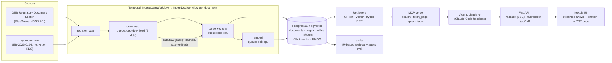

# OEB rate-case research agent

Ask a question about an Ontario Energy Board rate case and get an answer in which every claim
links to the page of the filing it came from. Built over two real proceedings:

| Case | Utility | Filing |
|---|---|---|
| [EB-2023-0195](https://www.rds.oeb.ca/CMWebDrawer/Record?q=CaseNumber:EB-2023-0195) | Toronto Hydro-Electric System Limited | 2025–2029 custom IR application, settled 2024 |
| EB-2026-0164 | Hydro One Networks Inc. | 2028–2032 joint transmission + distribution application, filed 2026-10-07 |

## The problem

A single rate case is hundreds of PDFs and tens of thousands of pages: pre-filed evidence,
interrogatories (written questions from intervenors and OEB staff) and the utility's responses,
undertakings, settlement proposals, decisions. Answering "what is the utility proposing and why"
means finding the right exhibit, tab, schedule and page, and quoting it exactly. This project
ingests whole cases, retrieves at page level, and answers with an agent that must cite pages it
actually read, or say the evidence isn't there.

## Architecture



**Ingestion.** `oeb.sources.rds` lists a case through RDS's JSON search API (100 records per page; 1,000
times out server-side) and downloads each record from `/CMWebDrawer/Record/{uri}/File/document`. Every
request goes through one fetcher that spaces requests ≥1.1 s apart per host (shared across processes
with a file lock), sends a descriptive User-Agent, caches every response on disk, and verifies the byte
count against both `Content-Length` and the size RDS lists (RDS once returned a body 80 KiB short with
a 200). PyMuPDF extracts text per page. Margin line numbers and the header block (`Exhibit 2B / Tab 1 /
Schedule 1 / Page n of m`) are stripped from the text, and the header becomes the page's exhibit
reference. pdfplumber extracts tables only on pages with ruling lines. Chunks follow detected headings,
target 500–800 tokens, never cross an exhibit boundary, and keep their page range. Embeddings use
`BAAI/bge-small-en-v1.5` locally.

**Orchestration.** One child workflow per document runs download → parse/chunk → embed. Each activity
is idempotent on `documents.status`, so re-running a case skips finished documents. Network-bound and
CPU-bound activities use separate task queues with separate concurrency limits, so a slow RDS response
(RDS sometimes takes >4 minutes to first byte) never blocks parsing. Activities heartbeat, so a
restarted worker's work is retried within a minute.

**Retrieval.** Three retrievers return chunks with case/exhibit/page citations:
1. *Full-text*: Postgres `tsvector` with `ts_rank_cd`. This is BM25-*style*, not BM25: there is no IDF
   term, so query words found in more than 10% of chunks ("toronto", "hydro", "rate") are dropped
   before ranking (a document-frequency table refreshed after each ingest).
2. *Vector*: cosine over bge-small embeddings (HNSW, iterative scan for filtered queries).
3. *Hybrid*: reciprocal rank fusion (k=60) over the top 50 of each.

**Agent.** The agent runs through Claude Code in headless mode (`claude -p`, model `claude-sonnet-5-5`)
on the user's own Claude login, with no API key. It's isolated from local Claude Code configuration: no
built-in tools, no settings/plugins/CLAUDE.md, no session persistence. Its only tools come from a stdio
MCP server:
- `search` (hybrid)
- `fetch_page`
- `query_table`: read-only SQL, run as a database role that can only SELECT two views

Every claim must carry a `[cite:doc_id:page]` token copied from a tool result. Tokens are then checked
against the pages the agent actually saw, and unverified ones are flagged in the UI.

## Evaluation

Ground truth comes from the case itself. In OEB proceedings, intervenors file interrogatories (IRs),
and the utility's written responses usually point to the evidence that answers them ("see Exhibit 2B,
Section E5.4"). `evals/build_ir_set.py` parses the utility's IR response documents into
(question, response, exhibits cited in the response) rows and keeps only rows with an explicit exhibit
reference.

**Leakage controls.** The IR responses are part of the corpus, and the questions themselves name
exhibits. So:
- Retrieval during eval is restricted to the utility's pre-filed **evidence**. IR responses,
  undertakings, settlement proposals, arguments and decisions (which quote IR answers) are excluded
  by a filter inside the SQL, which is equivalent to removing them from the index.
- Queries are the question with every record location stripped: exhibit/tab/schedule/page/section
  references, IR numbers (`2B-SEC-45` encodes the exhibit) and case numbers.
- Gold labels are the exhibits cited in the *response*, not the question's "Reference:" line. Both
  variants are reported.
- An ablation reruns hybrid search with IR documents left in to show what the leak would do.

**Metrics.**
- Retrieval: recall@k and MRR@10, where a hit is a chunk from a gold exhibit.
- Agent (held-out, seeded 60-question slice):
  - citation accuracy: does it cite a page from an exhibit the utility cited?
  - answer correctness: a Claude Opus 5.5 judge compares the answer with the utility's actual response.
- Hand checks: 20 seeded IR rows are reviewed for parsing precision (`evals/ir_sample_review.md`), and
  20 judge verdicts for human/judge agreement (`evals/judge_review.md`).

## Results

<!-- results:start -->
_Not yet generated. Run `uv run python -m evals.run`._
<!-- results:end -->

## Running it

Prerequisites: Docker, [uv](https://docs.astral.sh/uv/), Node 20+, the Temporal CLI
(`brew install temporal`), and [Claude Code](https://claude.com/claude-code) logged in (for the agent).

```bash
uv sync && npm --prefix web install
make up                                    # Postgres + Temporal dev server + worker + API + web UI
uv run python -m oeb.ingest EB-2023-0195   # in another shell; re-run any time, finished docs are skipped
uv run python -m oeb.ingest EB-2026-0164
uv run python -m evals.build_ir_set EB-2023-0195
uv run python -m evals.run                 # regenerates evals/results/* and the Results section above
```

- UI: http://localhost:3077
- API: http://localhost:8077/docs
- Temporal UI: http://localhost:8233

Raw PDFs are cached under `data/raw/` (git-ignored, ~1.25 GB for both cases).

`make check` runs ruff, pyright and pytest.

## Data and attribution

All filings are public records of the Ontario Energy Board's proceedings, retrieved from the
OEB's [Regulatory Document Search](https://www.oeb.ca/rds) and, for EB-2026-0164 (not yet posted
there), from [Hydro One's regulatory site](https://www.hydroone.com/about/regulatory/joint-rate-applications).
Source: Ontario Energy Board. Crown copyright and the filers' own rights apply to the documents.

This repository does not redistribute the PDFs. `data/raw/` is git-ignored, and the crawler fetches
them from the original sources. The eval set (`evals/data/ir_eval.jsonl`) and the hand-check sheets
quote interrogatory questions and Toronto Hydro's responses from the public record of EB-2023-0195,
for evaluation only.

The crawler:
- identifies itself in its User-Agent
- starts at most one request every 1.1 s per host
- keeps one download in flight by default
- backs off host-wide when a server starts failing
- never fetches the same file twice

## Built with Claude Code

This repo was built in a single Claude Code session. Claude Code:
- **Recon:** reverse-engineered the RDS WebDrawer JSON API from the public search form.
- **Code:** wrote the pipeline, retrievers, evals, agent and UI.
- **Debugging:** diagnosed problems from evidence rather than guessing:
  - a truncated download, found by comparing on-disk bytes with the listed size and the PDF's `startxref`
  - slow downloads blocking parsing, fixed by splitting the Temporal task queues
  - full-text search missing an obvious hit because `ts_rank_cd` has no IDF, fixed with the
    document-frequency filter
- **Agent wiring:** set up the agent to run through Claude Code headless.

A human made the calls on:
- which cases to use
- crawl politeness (≤1 request/s, backing off when the server struggles)
- running the agent on a Claude subscription instead of API billing
- the hand checks behind the precision and judge-agreement numbers
